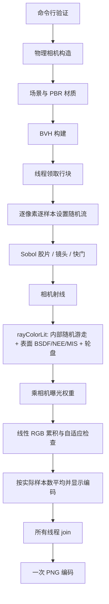

# ZRenderer

使用 **Zig 0.17** 编写的 CPU 路径追踪器，在 Windows / Zig **0.17.1** 上验证。
采用统一 BSDF、GGX 微表面、物理参数薄透镜、表面直接光照采样和 MIS，
并已接入闭合物体内部的均匀介质随机游走 SSS、真实位移水球，输出 PNG。
当前构建不使用 GPU，不需要 Vulkan SDK；stb 的 C 实现随项目编译。

数学与 API 导航：[表面 BSDF](docs/bsdf.md)、[体积/次表面散射](docs/subsurface.md)、
[位移水球](docs/water.md)、[几何](docs/geometry.md)、[光照与 MIS](docs/lighting.md)、
[物理相机](docs/camera.md)、[采样统计](docs/sampling.md)。

## 1. 构建与运行

将 Zig 加入 PATH 后，在项目根目录执行：

```powershell
zig build
zig build run -Doptimize=ReleaseFast -- --width 640 --samples 128
```

默认场景仍为 `random`，默认宽度仍为 **8640**，对应 **8640×4860**，不是 15360×8640 的标准 16K UHD。
默认最多 100 spp，预览必须显式降低宽度；Debug 构建不适合性能比较。
默认输出文件名是 random_scene.png，相对路径相对于**进程工作目录**。
仅构建不会渲染；`--output` 可指定完整输出路径，但父目录必须已存在。
生成程序安装于 zig-out/bin 目录。`--help` 只输出帮助，不构建场景。

```powershell
zig build run -Doptimize=ReleaseFast -- --width 640 --samples 128 --output preview.png
zig build run -Doptimize=ReleaseFast -- --width 640 --samples 256 --no-adaptive --threads 1
zig build run -Doptimize=ReleaseFast -- --width 640 --f-number 2.8 --iso 100 --exposure -3
zig build run -Doptimize=ReleaseFast -- --scene materials --width 640 --samples 512 --no-adaptive --output materials-preview.png
```

`--scene materials` 选择暗色摄影棚，适合观察水与玉石的参考外观；上述预算只是预览，不保证收敛。
选择场景不会自动修改输出文件名，建议显式指定 `--output`。

### 渲染与相机参数

| 参数 | 默认值 | 含义 |
| --- | --- | --- |
| `--scene random\|materials` | random | 随机球阵列或暗色双球摄影棚 |
| `--width N` | 8640 | 图像宽度，传感器宽高比 16:9，最小 4 |
| `--samples N` | 100 | 每像素最大预算，不向上取整 |
| `--threads N` | 0 | 0 自动，1 仅调用线程，其余为线程上限 |
| `--sampler sobol\|random` | sobol | 相机五维采样 |
| `--no-adaptive` | 未启用 | 固定预算，参考图建议使用 |
| `--min-samples N` | 16 | 自适应最早检查门槛，默认最早停止在 32 spp |
| `--relative-error E` | 0.05 | 线性 RGB 相对阈值，不是误差保证 |
| `--absolute-error E` | 0.002 | 线性 RGB 绝对阈值 |
| `--rr-depth N` | 5 | 第 N 次散射之后开始轮盘，不是最大深度 |
| `--output FILE` | random_scene.png | PNG 路径，父目录必须存在 |
| `--focal-length MM` | 50 | 镜头焦距，毫米 |
| `--f-number N` | 8 | 光圈数；改变景深和曝光 |
| `--focus-distance M` | random: 13.3；materials: 约 7.524 | 沿光轴的对焦距离，米；显式输入优先，必须大于焦距 |
| `--shutter SECONDS` | 0.008 | 快门持续时间，主场景限制在 $(0,1]$ 秒 |
| `--iso N` | 100 | 相对传感器增益，不模拟噪声 |
| `--exposure EV` | 0 | 显示前线性曝光补偿，允许负值 |
| `--fur-strands N` | 1800 | 随机场景大绒毛球毛束数，0 关闭细毛；最多 100000；摄影棚无毛束 |

增大毛束数会显著增加几何数量和 BVH 构建成本；每束使用两个胶囊体。
快门采样以秒为单位，场景运动区间与 BVH 均为 [0,1] 秒，禁止超出该区间。

## 2. 示例场景与实现边界

[scene.loadRandomScene()](src/scene.zig) 保留棋盘地面和随机小球阵列，添加三颗展示球。
默认视角中从左至右为**绒毛、体积玉石、水球**；部分随机小球也使用这些材质。
其余小球使用不同金属度和粗糙度的 PBR 或光滑玻璃。大面积顶灯提供可采样高光。

| 对象 | 实际实现 | 不包含 |
| --- | --- | --- |
| 水球 | `WavySphere` 静态隐式径向位移、真实轮廓/法线；IOR=1.333，精确 Fresnel、全反射及带 $\eta^2$ 的抛光折射 | 流体动力学、时变波浪、示例水的体吸收/散射、光谱响应 |
| 体积玉石球 | 抛光电介质边界＋内部均匀 RGB 吸收、标量散射率与 HG 多次空间随机游走；真实厚度相关 SSS | 实测玉石参数、矿物纹理、非均匀介质、粗糙折射、解析 BSSRDF/扩散近似 |
| 绒毛球 | 两段胶囊组成的弯曲细毛，真实轮廓和阴影，粗糙 GGX 表面 | 专用毛发 BSDF、纤维内部反射折射、毛发动力学 |
| 粗糙金属/塑料 | GGX + Smith + Schlick，保守互易漫反射能量预算 | 完整 glTF/Disney 兼容、多次微表面散射补偿、复杂涂层 |

两种场景的玉石均使用 **artist-chosen（美术选择，非实测）** 参数：
$\sigma_a=(0.65,0.10,0.32)\,\mathrm{m}^{-1}$、$\sigma_s=4\,\mathrm{m}^{-1}$、$g=0.35$、IOR=1.54。
展示球半径为 0.9 米，随机小球半径为 0.2 米，系数不随尺寸重缩放。
光学厚度为 $\tau_c=(\sigma_{a,c}+\sigma_s)\ell$；较短的薄边路径通常保留更多未散射透射，
中心长路径则更易散射、吸收，不能据此保证边缘一定比中心亮。详见 [厚度与参数](docs/subsurface.md)。

[scene.loadMaterialScene()](src/scene.zig) 在暗地面、RGB=(0.008,0.008,0.008) 环境下并排展示左水右玉，
使用顶侧柔光箱与背侧/侧面面灯，默认机位和对焦随预设切换，没有随机小球或毛束。
它提供受控的参考观察环境，不保证复现某张参考图：**灯的尺寸、位置、背景、几何轮廓/厚度和曝光同样关键**，
尤其透明水球不能只靠 IOR 复制参考外观。当前波场振幅比例为 0.045、频率为 14，不是法线贴图或流体模拟。

内部介质仅支持外部为空气、彼此分离的闭合物体；**不支持嵌套、相交介质或内部嵌入其他物体**。
没有体积 NEE、跨折射界面的显式光源连接或专用焦散求解器；小灯和长随机游走可能噪声很高。
低样本噪声不是玉石纹理，`Translucent` 仅保留为薄片漫透射模型，不再用于示例玉石。

## 3. 项目结构与对应类型

Zig 使用 `struct` 和带标签 `union`，没有传统继承式类。

| 模块 | 主要类型/API | 职责 |
| --- | --- | --- |
| [main](src/main.zig) | `Options.parse`、`main` | 参数、物理相机、运行与输出 |
| [scene](src/scene.zig) | `loadRandomScene`、`loadMaterialScene`、`addFur` | 示例材质、几何和灯光装配 |
| [render](src/render.zig) | `Scene`、`RenderParams`、`renderPixels`、`renderImage` | 场景容器、工作线程、像素累积和 PNG |
| [camera](src/camera.zig) | `PhysicalCameraArgs`、`Camera` | 薄透镜射线、快门、相对曝光 |
| [material](src/material.zig) | `Material`、`Pbr`、`Subsurface`、`Translucent` | 材质参数验证、BSDF 与内部介质查询 |
| [medium](src/medium.zig) | `Homogeneous` | RGB 吸收、标量散射自由程与 HG 相函数 |
| [water](src/water.zig) | `WavySphere` | 静态隐式位移曲面、解析几何法线和有界求根 |
| [bsdf](src/bsdf.zig) | `Surface`、`Sample` | `eval/pdf/sample`、GGX VNDF、Fresnel |
| [light](src/light.zig) | `Sampler`、`PointLight`、`DistantLight` | 选光概率、方向 PDF、MIS 权重 |
| [color](src/color.zig) | `rayColorLit`、`spawnRay`、`writeColor` | 表面/体积传输、NEE、MIS、轮盘与显示编码 |
| [object](src/object.zig) | `Object`、`HitRecord`、`Sphere`、`Capsule`、`BvhNode` | 相交、运动、几何采样、加速结构 |
| [texture](src/texture.zig) | `Texture`、`ImageTexture` | 常量、棋盘、Perlin、8 位图片 |
| [sampling](src/sampling.zig) | `PixelSampler`、`Estimate` | Sobol 随机数字平移、自适应估计 |
| [math](src/math.zig) | `Vec3`、`Ray`、`Onb`、`AabbRay` | 向量、坐标系和稳健包围盒 |
| [random](src/random.zig)、[noise](src/noise.zig) | 线程局部 PRNG、`Perlin` | 路径随机数和程序纹理 |
| [pdf](src/pdf.zig) | `Pdf` | 旧版余弦/形状/混合 PDF 兼容接口 |
| [stb 接口](src/stb.zig)、[C 包装](src/stb_impl.c) | 外部图像函数 | 图片解码、PNG 编码 |
| [构建](build.zig) | build/run/test | Zig 与 stb C 构建，C 警告检查 |

[Vulkan 绑定](src/vulkan.zig) 仅保留在仓库，当前不导入、不链接。

### 运行流程



场景使用 arena；渲染期间几何、材质、灯光切片和纹理必须只读且存活。
工作线程写互不重叠的行，没有逐像素锁。线程启动失败时先取消并 join，之后才能释放上下文。
`renderPixels` 返回调用者拥有的 RGB 字节缓冲；`renderImage` 负责释放自己的缓冲。
stb 图片不属于 Zig arena，需要调用 `ImageTexture.deinit()` 释放。

## 4. BSDF 数学与调用契约

渲染方程的表面部分为

$$
L_o(x,\omega_o)=L_e(x,\omega_o)+\int_{S^2}f_s(\omega_o,\omega_i)L_i(x,\omega_i)|n\cdot\omega_i|\,d\omega_i.
$$

两方向均从交点向外。BSDF 值不包含余弦，PDF 是立体角密度。连续样本通量更新为

$$
\beta' = \beta\frac{f_s(\omega_o,\omega_i)|n\cdot\omega_i|}{p_B(\omega_i)}.
$$

`Material.bsdfEval` 返回完整 RGB BSDF，`bsdfPdf` 返回所有瓣的混合 PDF，
`bsdfSample` 返回已计算好上述比值的 `Sample.weight`。**积分器不能再次除以 PDF。**
理想镜面/折射为 delta：`is_delta=true`，`pdf` 为离散分支概率，不与连续 PDF 比较。

微表面反射为

$$
f_r=\frac{D(h)F(\omega_o,h)G_1(\omega_o)G_1(\omega_i)}{4|n\cdot\omega_o||n\cdot\omega_i|},
\quad \alpha=\max(0.001,roughness^2).
$$

GGX 可见法线采样使用雅可比 $p_B(\omega_i)=p_h(h)/(4|\omega_o\cdot h|)$。
VNDF 反射到无效半球时返回 null，必须保留为零贡献，**不能不断重试直到成功**。
金属度混合得到 $F_0=(1-m)((\eta-1)/(\eta+1))^2+m\,baseColor$。
漫反射使用双方向 Fresnel 上界构造保守互易预算；不直接将无衰减 Lambertian 与镜面相加。
推导、能量界、采样密度和测试参考详见 [BSDF 文档](docs/bsdf.md)。

| API | 参数与返回约定 |
| --- | --- |
| `newPbr(alloc, Pbr)` | 线性 `base_color`、`metallic`、`roughness` 在 [0,1]；校验 IOR；分配错误可传播 |
| `newMetal(alloc, color, roughness)` | 零粗糙度保留常色理想镜面，其余使用 GGX |
| `newDielectric(alloc, ior)` | 空气/介质的光滑边界，透射权重含 $(\eta_i/\eta_t)^2$ |
| `newSubsurface(alloc, Subsurface)` | 同样的抛光边界＋`medium.Homogeneous`；系数有限非负，$\lvert g\rvert<0.99$ |
| `newTranslucent(alloc, color, transmission)` | 反射与漫透射概率分别为 $1-T,T$；不是粗糙折射 |
| `Surface.eval/pdf/sample` | 不依赖场景几何的闭包求值与采样；可独立测试 |

### 体积与水球 API 示例

以下片段放在场景装配代码中，沿用 [场景模块](src/scene.zig) 的 `alloc`、`scene`、`math`、`material`、`object` 和 `Color`；资源由场景 arena 管理：

```zig
const jade = try material.newSubsurface(alloc, .{
  .ior = 1.54,
  .medium = .{
    .sigma_a = Color.init(0.65, 0.10, 0.32),
    .sigma_s = 4,
    .g = 0.35,
  },
});
const center = math.Point3.init(1.1, 1, 0);
try scene.addObject(try object.newSphere(alloc, center, center, 0, 1, 0.9, jade));
const water = try material.newDielectric(alloc, 1.333);
try scene.addObject(try object.newWavySphere(alloc, .{ .x = -1.1, .y = 1 }, 0.9, 0.045, 14, water));
```

示例只装配双球，不自动布光；完成场景后需 `scene.buildBvh()` 并通过 `rayColorLit` 渲染。
`Subsurface.medium = .{}` 即吸收与散射系数全零，退化为**清澈、无体衰减的电介质**，不是黑色或漫反射；
IOR 不为一时仍有 Fresnel/折射。仅 `sigma_s=0`、吸收非零时则是 Beer 着色透明体。

内部估计为 $D\sim\mathrm{Exp}(\sigma_s)$、$\beta\leftarrow\beta e^{-\sigma_a\min(D,L)}$；
$D<L$ 时在真实位置按 HG 采样，$p_{HG}/q_{HG}=1$，不乘表面余弦。
散射生存概率已由自由程承担，**不能再乘 `transmittance()` 或散射反照率**。
完整推导、参数域及集成状态见 [次表面散射文档](docs/subsurface.md)，位移与求根见 [水球文档](docs/water.md)。

## 5. 直接光照与 MIS

每个具有非 delta BSDF 的**表面顶点**先抽取一个灯光样本、做阴影测试并累积 NEE，然后独立抽取 BSDF 继续路径。
灯光候选为面积形状组、恒定环境、各点光源和各方向光，当前等概率选取。
连续方向的 PDF 包含选光与组选形状概率。

$$
\widehat L_L=\frac{f_sL_e^{vis}|n\cdot\omega_L|}{p_L}w_L,
\qquad w_L=\frac{p_L^2}{p_L^2+p_B^2},\quad w_B=1-w_L.
$$

BSDF 路径下一次命中发光/环境时只给该发光项乘 $w_B$，不缩放整条后续路径。
因此两个估计量的期望是 $\int g(w_L+w_B)d\omega=\int g\,d\omega$，不会重复照亮。
相机直接看到发光、delta 链后的发光和解析 delta 灯的 NEE 使用权重一。
点光强度按 $I/r^2$ 衰减，阴影检查不越过灯的位置；方向光检查无限远。
体积顶点没有配对的 NEE，不能套用表面光源 MIS；HG 事件会清除前序表面的 MIS 状态。
玉石路径实际随机游走至边界，再经反射或折射继续。直线 NEE 把玻璃/玉石边界作为遮挡，
并未求解折射连接；解析点灯/方向光的镜面链不能靠增加普通路径样本恢复。

面积提议采用**方向空间估计**：实际辐亮度来自该方向首个可见表面或环境，
而不是强行使用所选形状的发光。灯形状通常应同时注册在世界中，方向 PDF 与运动时间一致。
非采样形状仍可被 BSDF 命中，但不能充当任意有效的灯光采样代理。

`rayColorLit(ray, world, Sampler, depth, rr)` 是主入口；旧 `rayColor` 自动适配。
`RenderParams.point_lights`、`distant_lights`、`sample_environment` 提供程序化控制。
详细测度、遮挡、轮盘证明和数值参考见 [光照文档](docs/lighting.md)。

## 6. 物理参数薄透镜

场景 **1 单位 = 1 米**；焦距和传感器尺寸以毫米输入，内部转为米。
物距为 $u$、像距为 $v$、焦距为 $f$，薄透镜满足

$$
\frac1f=\frac1u+\frac1v,\quad v=\frac{fu}{u-f},\quad
W_{focus}=S_wu/v,\quad H_{focus}=S_hu/v,\quad r_{lens}=\frac{f}{2N}.
$$

同一胶片样本对应唯一焦平面点，不同镜头圆盘样本从不同起点发向该点，形成景深。
快门均匀采样 $t=t_0+\xi(t_1-t_0)$。相对曝光为

$$
E=\frac{\Delta t/N^2}{(1/125)/8^2}\frac{ISO}{100}2^{EV}.
$$

默认参考曝光为一；增大光圈会同时改变景深和亮度，若只比较景深需用 EV 抵消亮度。
渲染器在**线性样本累积前**应用 `Camera.sampleWeight(s,t)`；可选自然暗角为 $E\cos^4\theta$。
这是理想薄透镜与相对摄影曝光，不是多片镜头、衍射、绝对标定传感器或传感器噪声模拟。
完整 API、参数验证与推导见 [相机文档](docs/camera.md)。

## 7. 加速、采样与稳定性

- BVH 缓存子包围盒，最长质心轴中位划分，近子节点优先；单叶不重复求交。
  当前仍为指针式 BVH，构建含插入排序，不适合无上限增加毛束，不是 SAH/扁平 BVH。
- 默认线程数为逻辑 CPU 数，受行块数限制；默认每任务 8 行，调用线程也参与。
- RNG 按像素和样本播种；同一构建与参数下，线程数/行块调度不改变输出。
- Sobol 只用于胶片 2D、镜头 2D、快门 1D，八个随机数字平移副本；后续路径使用 PRNG。
  不是全路径 Sobol 或完整 Owen scrambling；基础点缓存最多 80 KiB。
- 八副本的均值估计线性 RGB 误差；需连续两个检查点达标，默认最早 32 spp 停止。
  自适应停止有可选停止偏差及稀有高亮漏检风险，**参考图须关闭**。
- 轮盘仅除实际存活概率，折射率补偿只用于重要性判断，不额外乘入辐亮度。
- 阴影与延续射线采用方向相关几何法线偏移；其下限 $10^{-8}$ 米不是严格误差传播界。

采样统计推导见 [采样文档](docs/sampling.md)，胶囊体与方向 PDF 推导见 [几何文档](docs/geometry.md)。

## 8. 测试与注释规范

```powershell
zig build test --summary all
zig build test -Doptimize=ReleaseSafe --summary all
zig build test -Doptimize=ReleaseFast --summary all
zig build test "-Dtest-filter=lighting"
```

根测试 [tests](src/tests.zig) 汇总 [BSDF](src/bsdf_tests.zig)、[相机](src/camera_tests.zig)、
[几何](src/geometry_tests.zig)、[光照](src/lighting_tests.zig)、[场景](src/scene_tests.zig)、
[BVH](src/bvh_tests.zig)、[积分器](src/integrator_tests.zig)、[采样](src/sampling_tests.zig)、
[介质](src/medium_tests.zig)、[SSS 端到端](src/subsurface_tests.zig) 和 [水球](src/water_tests.zig) 测试。
覆盖能量上界、互易性、独立数值求积、VNDF null 概率、TIR、折射权重、光源遮挡、
相机对焦与实际曝光输出、OOM、线程一致性和 PNG 上下方向。
统计测试固定种子和样本预算，有明确绝对误差容差，不把参考值直接取自被测 API。
VS Code 测试配置通过构建脚本链接 stb/libc；不要绕过构建直接运行主测试根。

自有代码注释使用中文及 `// @brief`、`// @param`、`// @return`、`// @notice`；
核心推导使用 `// @method`，内容为 Markdown + LaTeX；不存在的项不硬凑。
第三方 stb 头、生成 Vulkan 绑定和版权/许可文本保持原样，防止破坏上游维护和许可证。
规则见 [注释规范](docs/comments.md)。

本轮完整测试在 Debug、ReleaseSafe、ReleaseFast 下均为 **152/152 通过**。
实际体散射摄影棚的单线程与四线程 PNG 散列一致；
[640×360、2048 spp 对照图](.zig-cache/materials-sss-final.png) 已生成并检查（左水右玉，缓存清理后链接失效）。
预览仍有噪点，不代表收敛。测试、图像及数值限制见 [验证记录](docs/validation.md)，其中旧薄层玉石结果单独标为历史基线。

## 9. 当前未覆盖的 PBR 能力

- 不支持 PBRT/glTF 导入、三角网格、法线/粗糙度贴图、HDR 纹理环境、光谱渲染。
- 图片纹理仍是 8 位最近点采样，尚未自动执行 sRGB 解码；本示例材质使用明确的线性常量。
- 输出仍为 gamma 2.2 的 8 位 PNG 并截断显示范围，无 EXR/HDR 输出或色调映射。
- 已支持闭合抛光物体内的均匀随机游走 SSS；不支持非均匀/一般场景体积、RGB 独立散射率、粗糙折射、嵌套/相交介质或内部嵌入其他物体。
- `Isotropic`/`ConstantMedium` 是旧兼容路径，不是主积分器此次新增体积支持的入口；使用 `newSubsurface`。
- 没有体积 NEE、折射连接或专用焦散求解器。面灯/环境的折射焦散依赖普通路径追踪，可能高噪声；解析 delta 灯的镜面链不受支持。
- 旧 `rayColorWithBvh`/`rayColorWithoutBvh` 为兼容入口，不支持完整新材质，勿用于新场景。

新增物理模型、MIS、相机和几何会改变原图；应比较解析或高样本参考，不要求与历史简化渲染逐像素一致。
